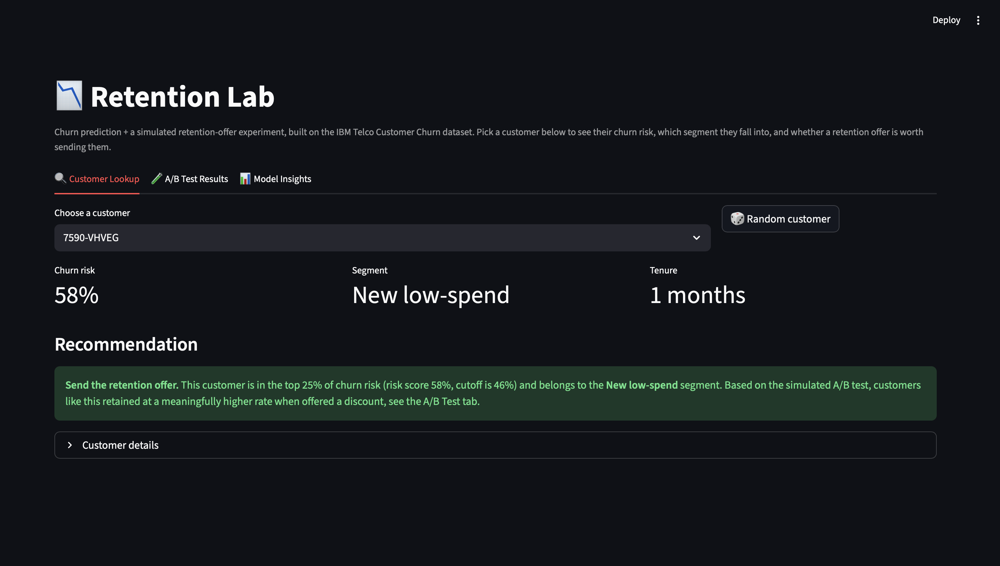

# Retention Lab

A churn prediction model plus a simulated retention-offer experiment, built
on the IBM Telco Customer Churn dataset. Basically pretending to be a data
scientist at a subscription company trying to figure out who's about to
leave and whether it's worth paying to keep them.

   

## What it does

### Churn prediction
Trained two models on customer demographics, contract type, and usage data:
a Logistic Regression baseline and a Random Forest. Random Forest edges it
out slightly (0.845 ROC-AUC vs 0.841), but the more useful change wasn't
picking a better model, it was picking a better threshold.

The business reason: missing an actual churner costs more than flagging a
loyal customer by mistake. A missed churner is lost revenue; a false alarm
just means someone gets an email they didn't need. So instead of the
default 0.5 cutoff, I lowered the decision threshold to 0.35, which trades
some precision for a lot of recall: catches 90% of actual churners instead
of 80%, at the cost of more false positives. Which tradeoff is "right"
depends on how much the offer costs vs. how much a lost customer is worth,
which is a business call, not a modeling one, but the model should at
least make that tradeoff visible instead of hiding it behind accuracy.

Biggest churn drivers by feature importance: tenure, contract length,
fiber optic internet, and paying by electronic check. All of that lines up
with the raw churn rates in the data: month-to-month customers churn at
43%, two-year contract customers churn at under 3%.

### Simulated A/B test
The dataset doesn't include a real experiment, so I'm upfront that this
part is simulated, same move as the fake ratings in my last project. I'm
not claiming I ran a real test here, just showing I know how to set one up
and analyze it correctly.

Took the riskiest 25% of customers by predicted churn probability, randomly
split them into treatment (gets a retention discount) and control (doesn't),
and simulated outcomes with a 25% relative reduction in churn probability
for the treatment group: a believable effect size, not something rigged to
obviously "prove" the offer works. Then ran a two-proportion z-test
(cross-checked with chi-square, they agree) on retention rate between the
two groups.

Result: treatment group retained at 42.2%, control at 22.1%, a 20-point
lift, p < 0.0001, 95% CI [15.7pt, 24.4pt]. Statistically significant and a
big enough effect that it'd actually be worth running for real.

### Segmentation
K-means on tenure, monthly charges, and total charges, not on churn risk
itself (clustering on the thing you're about to make decisions with just
reproduces the model), to split customers into four segments: Loyal
high-value, Loyal low-spend, New low-spend, and New high-value (at-risk).

That last one is the interesting one: 2,276 customers, 70% average churn
risk, $81/month average revenue. High risk of leaving *and* real revenue to
protect, which is where a retention offer actually has good ROI. A low-spend
customer who's about to churn isn't worth discounting; this segment is.

### The app
Streamlit app with three tabs: look up a customer and see their risk score,
segment, and whether they should get the offer; the A/B test results; and
the model's feature importance and segment breakdown.

## Built with
Python, pandas, scikit-learn, scipy, Streamlit

## Running it

```bash
git clone <repo-url>
cd retention-lab
pip install -r requirements.txt

# run these once, in order, to generate the model + results the app reads
python src/train_churn_model.py
python src/ab_test.py
python src/segmentation.py

streamlit run app/app.py
```

Needs the Telco Customer Churn CSV in `data/telco_churn.csv`, grab it from
Kaggle (search "Telco Customer Churn") or IBM's sample datasets.

## Stuff that's not perfect / what I'd fix with more time
- the A/B test is simulated, so the effect size is something I chose to be
  realistic, not something that happened; a real version of this needs an
  actual experiment
- only used tenure/charges for segmentation; a real version would probably
  add usage features (streaming, add-on services) to split segments further
- the recall/precision tradeoff threshold (0.35) was picked by eyeballing
  the classification report, not from an actual cost-benefit calculation.
  A real version would plug in the actual offer cost and customer lifetime
  value and optimize for expected profit, not just recall
- Random Forest beat Logistic Regression by less than half a point of AUC,
  which says the relationship here is mostly linear. A more complex model
  (gradient boosting, some interaction terms) might do better, but wasn't
  worth it for how small the gain looked early on
